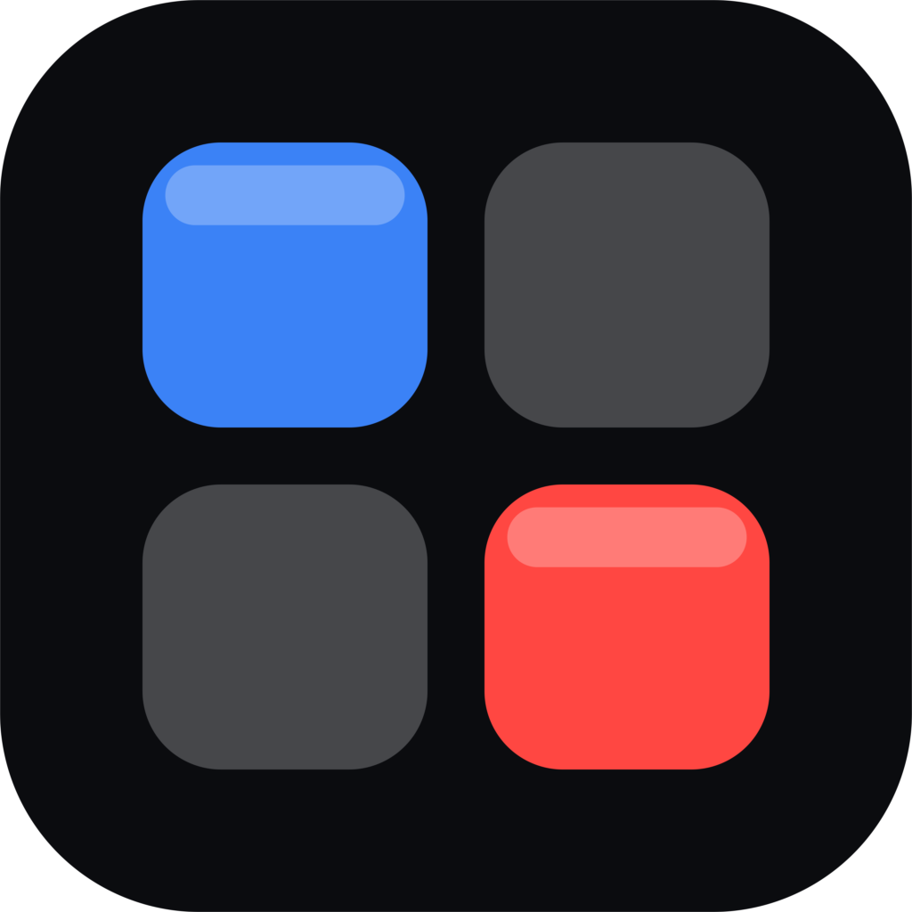
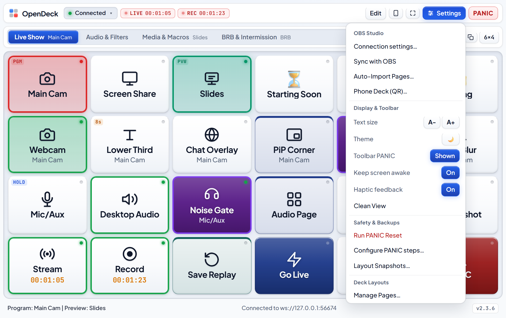

#  OpenDeck

[](https://github.com/JWCow/OpenDeck/releases/latest)
[](https://github.com/JWCow/OpenDeck/releases/latest/download/opendeck.zip)
[](#quick-start-obs-custom-browser-dock)

**Virtual Stream Deck for OBS Studio (`obs-websocket` v5) — zero-backend broadcast console.**  
Run it three ways with the exact same Deck, Pages, and Pads:

- 🖥️ **[Desktop App](#%EF%B8%8F-desktop-app-electron)** — Standalone Electron app for **Windows** (`.exe`), **macOS** (`arm64`/`x64` `.dmg`/`.zip`), and **Linux** (`.AppImage`) with tray controls, Always on Top & 1-click Phone Deck QR
- 🔌 **[OBS Browser Dock](#quick-start-obs-custom-browser-dock)** — Drop `deck.html` from [`opendeck.zip`](https://github.com/JWCow/OpenDeck/releases/latest/download/opendeck.zip) into an OBS Custom Browser Dock (no plugins, no server)
- 📱 **[Phone / Tablet Deck](#-phone-deck)** — Control OBS from any phone on Wi-Fi via **Phone Deck (QR)** (1-click in Desktop App, or offline QR + `Phone Helper` in browser/dock)

**[⬇️ All Desktop & Dock Downloads](https://github.com/JWCow/OpenDeck/releases)** · **[⬇️ Latest opendeck.zip](https://github.com/JWCow/OpenDeck/releases/latest/download/opendeck.zip)**

<br>


<br>

## ✨ Highlights

| | Feature | What it does |
|---|---|---|
| ✨ | **Anodized Console UI & Live Strip** | Clickable status pill, cross-page `LIVE` / `REC` / `PAUSED` timecode strip, `Edit` / `Commands` / `Phone Deck` / `Clean View` / `Settings` / `PANIC` header, plus `PVW`/`PGM` & `HOLD`/timer cue badges |
| 🖥️ | **Standalone Desktop App** | Windows, macOS & Linux app with `app://opendeck/` storage, tray, Always on Top & 1-click Phone Deck QR host |
| 🪄 | **Auto-Import (Read-Only)** | Reads your OBS scenes, sources, filters & audio into ready Pages with selective scene filtering, Starter Layouts & live preview counts |
| 🎛️ | **24 Actions & Hold Pads** | Scenes, PiP, filters, audio, media, text/counters, streams, stats, hotkeys, HTTP & Hold-to-Run |
| 🎨 | **Broadcast Icons, Styles & Art** | Built-in Broadcast SVG icons + Emoji library, Solid vs Soft Tint styles, or custom PNG/JPG/WebP/SVG Pad Graphics (`Fit Icon`, `Full Face`, `Hide Text`) |
| 📄 | **Pages, Search & Context Menus** | `2×2` to `12×12` grids (active grid-size button, e.g. `6×4` / `8×8`), Scene-Linked Pages, Quick Search (`Ctrl+K`), Manage Pages (search, bulk delete/export), right-click Pad & Page menus, Undo/Redo, crisp down to `360×420` |
| ⏱️ | **Timers, Macros & PANIC** | Auto-Off countdowns, multi-step Timed Macros with abort cleanup & **PANIC** (toggleable in **Settings**) |
| 🌓 | **Themes, Sizing & Clean View** | Dark/Light Studio toggle, `A-` / `A+` Font Scale & top-bar **Clean View** (`?clean=1`) |
| 💾 | **Portable JSON & Snapshots** | **Export Deck**, **Import Pages…**, **Import from Link…** & IndexedDB **Layout Snapshots…** |

<br>


> **Edit Mode:** Click **Edit** to toggle the **Commands** palette and drag actions onto Pads, drag Pads across Page tabs, reorder Pages, open the tabbed **All / Action / Appearance** Pad Editor, right-click Pads or Page tabs (Edit, Run, Duplicate, Copy, Paste, Paste Style, Move to Page, Clear), or multi-select to duplicate, recolor, and move in bulk.

<br>



> **Light Studio & Settings Menu:** Switch between Dark/Light Studio themes, adjust `A-`/`A+` text size, toggle **Toolbar PANIC**, enable **Clean View** (`?clean=1`), or open **Connection settings…**, **Auto-Import Pages…**, **Phone Deck (QR)…**, **Layout Snapshots…**, **Manage Pages…**, and **Export Deck** from **Settings**.

<br>


> **Tabbed Pad Editor:** Switch between **All**, **Action**, and **Appearance** tabs with a live Pad preview, built-in **Broadcast** SVG & **Emoji** icon libraries, **Solid** vs **Soft Tint** surface styles, and custom Pad Graphics.

<br>

<details>
<summary>📋 <strong>All 24 Action Types</strong></summary>

<br>

| Category | Action | Tag | Capabilities |
|---|---|---|---|
| 🎬 **Scenes** | Switch Scene | `SCN` | Named scene, Next, or Previous *(Studio Mode `PVW`/`PGM` badges)* |
| | Studio Mode | `STD` | Toggle, load Preview, or Transition *(Auto-Off)* |
| | Scene Transition | `TRN` | Switch transition & duration |
| 🧩 **Sources** | Source Visibility | `SRC` | Toggle, Show, Hide, Solo *(Auto-Off, Hold)* |
| | Transform / PiP | `PIP` | Corner PiP, Center 50%, or Reset |
| | Media Playback | `MED` | Play/Pause, Restart, Stop, Next, Prev *(Auto-Off)* |
| | Image / Slideshow | `IMG` | Swap image path or step slides |
| | Text / Counter | `TXT` | Set text, cycle presets, or `+/-` counter *(Auto-Off)* |
| | Browser Source | `WEB` | Refresh cache or update URL |
| | Take Screenshot | `CAP` | Snapshot source or scene |
| 🎚️ **Filters & Audio** | Filter Control | `FLT` | Toggle, Enable, or Disable *(Auto-Off, Hold)* |
| | Input Mute | `MUT` | Toggle, Mute, or Unmute *(Auto-Off, Hold)* |
| | Input Volume | `VOL` | Set dB or step `+/- dB` *(Auto-Off, Hold)* |
| | Audio Monitor | `MON` | Off / Monitor Only / Monitor & Output |
| 📡 **Broadcast** | Stream / Record / Cam | `OUT` | Stream, Record, Pause, VCam, Replay *(Auto-Off)* |
| | Recording Chapter | `CHP` | Insert chapter marker |
| | Telemetry Stats | `STS` | Live CPU %, FPS & dropped frames |
| | OBS Hotkey | `KEY` | Trigger OBS hotkey by name or key sequence |
| | Switch Profile | `PRF` | Switch OBS Profile |
| | Scene Collection | `COL` | Switch OBS Scene Collection |
| ⚡ **Automation** | Switch Page | `PAG` | Jump to Page or Next / Prev |
| | Timed Macro | `MCR` | Multi-step sequence with `Wait (ms)` & abort cleanup |
| | HTTP / Webhook | `API` | `GET`/`POST`/`PUT` webhook or local bridge call |
| | PANIC Reset | `PNC` | Abort timers & run recovery steps |

</details>

<br>

## 🖥️ Desktop App (Electron)

Prefer a standalone window instead of an OBS dock? Download the desktop installer (**Windows** `.exe`, **macOS** Apple Silicon `arm64` & Intel `x64` `.dmg`/`.zip`, **Linux** `.AppImage`) from [Releases](https://github.com/JWCow/OpenDeck/releases) or run it from source.

- **Stable storage & tray controls:** Serves the Deck from a fixed `app://opendeck/` origin (preserving layouts across updates and Linux AppImage mounts) with window state persistence, Always on Top (`Ctrl/Cmd+Shift+T`), and system tray controls.
- **Auto port discovery (ADR-0002):** Reads OBS `obs-websocket/config.json` read-only for `server_port` on launch and never reads or persists passwords.
- **Windows download choice & first launch:** Use **`OpenDeck.Setup.<version>.exe`** (recommended) for daily use — it installs once and opens right away, whereas the portable **`OpenDeck.<version>.exe`** re-extracts into `%TEMP%` on every launch. Until Windows code signing is active, Windows SmartScreen or third-party antivirus (e.g., Avast AutoSandbox) may briefly scan or prompt on first launch (`More info` → `Run anyway`, or allow the installed binary).
- **macOS first launch:** Builds are currently unsigned — Right-click `OpenDeck.app` → **Open** (or run `xattr -cr /Applications/OpenDeck.app`), and allow the **Local Network** prompt on macOS Sequoia so OpenDeck can connect to OBS (`ws://127.0.0.1` or LAN). Building macOS `.dmg`/`.zip` targets locally requires a Mac (CI builds them on `macos-latest`).

<br>

## 🚀 Quick Start (OBS Custom Browser Dock)

**1. 📦 Install** — Download & extract [`opendeck.zip`](https://github.com/JWCow/OpenDeck/releases/latest/download/opendeck.zip) (it unpacks to an `obs-virtual-deck` folder), then run the setup helper inside. It copies OpenDeck to `Documents/obs-virtual-deck` and **copies the dock URL to your clipboard**:
- 🪟 **Windows:** `Install-Windows.bat` *(SmartScreen: More info → Run anyway)*
- 🍎 **macOS:** `Install-Mac.command` *(Right-click → Open, or run `bash ~/Downloads/obs-virtual-deck/Install-Mac.command` if extracted in Downloads)*

<br>

**2. 🔌 Enable WebSocket** — In OBS: **Tools → WebSocket Server Settings** → check **Enable WebSocket server** (`4455`).

<br>

**3. 🖥️ Add OBS Dock** — **Docks → Custom Browser Docks...** → name it `OpenDeck` → paste the `file:///.../deck.html` URL the installer copied (it also prints it in the installer window) → **Apply**.

<br>

**4. 🔗 Connect** — Click the status pill (or open **Settings → Connection settings…**), enter your password in **Pass** (if set), click **Connect**, and run **Settings → Auto-Import Pages…** *(the Desktop App and installers auto-detect your OBS port via ADR-0002 without storing passwords)*.

> 💡 *Upgrading from v1/v2.x?* Opening `deck.html` at the same `file://` path migrates your layout automatically. Click **Settings → Export Deck** first for a backup.

<br>

## 📱 Phone Deck

Control OBS from a phone or tablet on the same Wi-Fi using the universal **Phone Deck (QR)** dialog — click the top-bar **Phone Deck** icon or open **Settings → Phone Deck (QR)…**.


- **Desktop App (1-click):** Opening **Phone Deck (QR)** automatically starts the built-in local LAN host, generates a QR code, and syncs layout edits live — no Node.js or extra script needed.
- **OBS Browser Dock / Browser:** Enter your computer's Wi-Fi IP in the **Phone Deck (QR)** dialog to generate an offline QR code directly on the page, then start OBS (WebSocket server enabled) and run **Phone Helper.bat** (Windows) or `node scripts/lan-helper.mjs` (requires [Node.js](https://nodejs.org)). Use **Export Layout** in the dialog (or **Settings → Export Deck**) to share your layout via `Downloads/obs-virtual-deck*.json` or `layout.json` in the deck folder.

| Good to know | |
|---|---|
| Port | Uses `8765`; if taken, any free port (adjust in **Helper Port** or the `.bat`). |
| Several devices | Any number of phones can open the same link. Each keeps its own layout. |
| OBS detection | Desktop App auto-detects the local OBS port across platforms; `Phone Helper` auto-detects on Windows and uses `4455` or `--obs-port=` elsewhere. |
| Load a layout by hand | **Settings → Import from Link…** with `http://<ip>:<port>/layout.json`. |
| Password | Never in the link or QR code. Type it once on the phone (click the status pill or **Settings → Connection settings… → Pass**). |

<br>

## 🛠️ Troubleshooting

| Symptom | Fix |
|---|---|
| 🔴 **Disconnected** | Check OBS **Tools → WebSocket Server Settings → Enable WebSocket server** |
| 🔑 **Auth Failed** | Copy password from OBS **Show Connect Info** into **Settings → Connection settings… → Pass** (or click the status pill) |
| ⬜ **Blank Dock** | URL must start with `file:///` and point to `deck.html` (macOS: allow Files & Folders access) |
| 🔄 **Missing Items** | Connect to OBS, then click **Settings → Sync with OBS** |
| 📂 **Layout Reset / Sharing** | Layouts live in browser storage, not the folder — click **Settings → Export Deck** (saving `layout.json` in the deck folder also lets `Phone Helper.bat` and external tools read/extend your deck), **Settings → Import Pages…** to append Pages onto an active Deck, **Manage Pages…** to bulk export/delete, or **Settings → Layout Snapshots…** to roll back |
| ⌨️ **External App Hotkeys** | For OS hotkeys outside OBS (triggered via `API` / `http` pads), launch optional **Hotkey Bridge.bat** (`127.0.0.1:3905/hotkey`) |

<br>

## 🖥️ Multiple OBS Computers

> 💡 **Tip:** Open one dock per OBS machine (e.g. a gaming PC and a streaming PC) and point each at its own OBS with `?host=` and `?port=` in the dock URL.

| Computer | Dock or Phone URL |
|---|---|
| 🎮 **Gaming PC** (local) | `file:///.../obs-virtual-deck/deck.html?port=4455` |
| 📡 **Streaming PC** (remote) | `file:///.../obs-virtual-deck/deck.html?host=192.168.1.50&port=4455` |

Each dock connects to the OBS in its own URL, but **both share one layout**: the browser keeps a single storage area for every `file://` page, so copying the folder does not separate them. Keep the controls for both machines on separate Pages. Leave the **Host** and **Port** fields in **Settings → Connection settings…** alone in these docks; typing a host or port there is saved and then overrides the URL in every dock. On Phone Deck, add the same `?host=` and `?port=` to the LAN URL (e.g. `http://192.168.1.50:8765/deck.html?host=192.168.1.50&port=4455`).

<br>

## 🧑‍💻 Docs & Dev

📖 [Glossary](GLOSSARY.md) · [ADRs](docs/adr/) · [Agent Guide](AGENTS.md)

```bash
npm install && npx playwright install chromium
npm run check                  # Static syntax, version & PAD_TYPES parity checks
npm test                       # Playwright E2E suites (--section=18 for feature subset)
npm run build:release          # Build release ZIPs in dist/
npm --prefix electron install  # Install isolated Electron desktop dependencies
npm run desktop                # Launch the Electron desktop app
npm run build:desktop          # Build desktop installers in electron/dist/
npm run build:desktop:mac      # Build macOS arm64 + x64 .dmg/.zip (requires macOS)
```

<br>

## 🔐 Security, Code Signing & Privacy

- **Code signing status:** Desktop installers (Windows `.exe`, macOS `.dmg`/`.zip`, Linux `.AppImage`) are currently **unsigned** (built directly by GitHub Actions from tagged releases). See the [Desktop App](#%EF%B8%8F-desktop-app-electron) notes above for first-launch SmartScreen / Gatekeeper steps.
- **Privacy:** OpenDeck is 100% local and zero-backend. It collects no analytics or telemetry and communicates only with your local/LAN OBS Studio (`obs-websocket`) instance and any URLs you explicitly configure in `API` / `http` pads.
- **License:** Open-source software licensed under the [MIT License](LICENSE).
