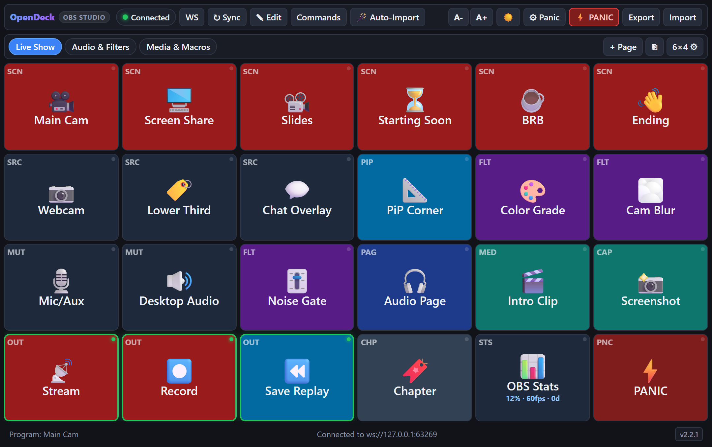
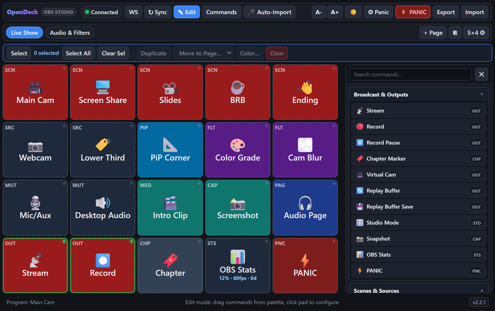

# 🎛️ OpenDeck

[](https://github.com/JWCow/obs-virtual-deck/releases/latest)
[](https://github.com/JWCow/obs-virtual-deck/releases/latest/download/opendeck-v2.2.1.zip)
[](#quick-start)

**Zero-backend virtual Stream Deck for OBS Studio.**  
Drop `deck.html` into an OBS Custom Browser Dock — no plugins, no server, no build step.

**[⬇️ Download opendeck-v2.2.1.zip](https://github.com/JWCow/obs-virtual-deck/releases/latest/download/opendeck-v2.2.1.zip)** · [All Releases](https://github.com/JWCow/obs-virtual-deck/releases)

<br>



<br>

## ✨ Highlights

| | Feature | What it does |
|---|---|---|
| 🪄 | **Auto-Import** | Reads your OBS scenes, sources, filters & audio into ready pages |
| 🎛️ | **22 OBS Actions** | Scenes, PiP, filters, audio, media, streams, stats, hotkeys & more |
| 🖼️ | **Custom Icons** | Upload PNG/JPG/WebP/SVG artwork (Fit Icon, Full Face, Hide Text) |
| 📄 | **Pages & Grids** | Switchable tabs from `3×2` to `12×10`, crisp down to `360×420` docks |
| ⏱️ | **Timers & Macros** | Auto-Off countdowns, multi-step macros, and one-click **⚡ PANIC** |
| 🌓 | **Themes & Sizing** | Dark/Light studio toggle + `A-` / `A+` font scaling |
| 💾 | **Portable JSON** | Export/import layouts cleanly (passwords stripped) |

<br>



> **✎ Edit Mode:** Drag commands from the right palette onto pads, drag pads across Page tabs, or multi-select to duplicate, recolor, and move in bulk.

<br>

<details>
<summary>📋 <strong>All 22 OBS Action Types</strong></summary>

<br>

| Category | Action | Tag | Capabilities |
|---|---|---|---|
| 🎬 **Scenes** | Switch Scene | `SCN` | Named scene, Next, or Previous |
| | Studio Mode | `STD` | Toggle, load Preview, or Transition *(Auto-Off)* |
| | Scene Transition | `TRN` | Switch transition & duration |
| 🧩 **Sources** | Source Visibility | `SRC` | Toggle, Show, Hide, or Solo *(Auto-Off)* |
| | Transform / PiP | `PIP` | Corner PiP, Center 50%, or Reset |
| | Media Playback | `MED` | Play/Pause, Restart, Stop, Next, Prev *(Auto-Off)* |
| | Image / Slideshow | `IMG` | Swap image path or step slides |
| | Browser Source | `WEB` | Refresh cache or update URL |
| | Take Screenshot | `CAP` | Snapshot source or scene |
| 🎚️ **Filters & Audio** | Filter Control | `FLT` | Toggle, Enable, or Disable *(Auto-Off)* |
| | Input Mute | `MUT` | Toggle, Mute, or Unmute *(Auto-Off)* |
| | Input Volume | `VOL` | Set dB or step `+/- dB` |
| | Audio Monitor | `MON` | Off / Monitor Only / Monitor & Output |
| 📡 **Broadcast** | Stream / Record / Cam | `OUT` | Stream, Record, Pause, VCam, Replay *(Auto-Off)* |
| | Recording Chapter | `CHP` | Insert chapter marker |
| | Telemetry Stats | `STS` | Live CPU %, FPS & dropped frames |
| | OBS Hotkey | `KEY` | Trigger any OBS hotkey |
| | Profile / Collection | `PRF` / `COL` | Switch OBS Profile or Scene Collection |
| ⚡ **Automation** | Switch Page | `PAG` | Jump to Page or Next / Prev |
| | Timed Macro | `MCR` | Multi-step sequence with `Wait (ms)` |
| | PANIC Reset | `PNC` | Abort timers & run recovery steps |

</details>

<br>

## 🚀 Quick Start

**1. 📦 Install** — Download & extract the ZIP, then run the setup helper inside:
- 🪟 **Windows:** `Install-Windows.bat` *(SmartScreen: More info → Run anyway)*
- 🍎 **macOS:** `Install-Mac.command` *(Right-click → Open, or `bash ~/Downloads/obs-virtual-deck/Install-Mac.command`)*

<br>

**2. 🔌 Enable WebSocket** — In OBS: **Tools → WebSocket Server Settings** → check **Enable WebSocket server** (`4455`).

<br>

**3. 🖥️ Add OBS Dock** — **Docks → Custom Browser Docks...** → name it `OpenDeck` → paste the copied `file:///.../deck.html` URL → **Apply**.

<br>

**4. 🔗 Connect** — Click **WS**, enter your password (if set), click **Connect**, and run **🪄 Auto-Import**.

> 💡 *Upgrading from v1/v2.x?* Opening `deck.html` at the same `file://` path migrates your layout automatically. Click **Export** first for a backup.

<br>

## 🛠️ Troubleshooting

| Symptom | Fix |
|---|---|
| 🔴 **Disconnected** | Check OBS **Tools → WebSocket Server Settings → Enable WebSocket server** |
| 🔑 **Auth Failed** | Copy password from OBS **Show Connect Info** into **WS → Pass** |
| ⬜ **Blank Dock** | URL must start with `file:///` and point to `deck.html` (macOS: allow Files & Folders access) |
| 🔄 **Missing Items** | Connect to OBS, then click **↻ Sync** |
| 📂 **Layout Reset** | `localStorage` follows the file path — **Export** before moving the folder |

<br>

## 🧑‍💻 Docs & Dev

📖 [Glossary](GLOSSARY.md) · [ADRs](docs/adr/) · [Agent Guide](AGENTS.md)

```bash
npm install && npx playwright install chromium
npm test               # Playwright E2E suites
npm run build:release  # Build release ZIPs in dist/
```
